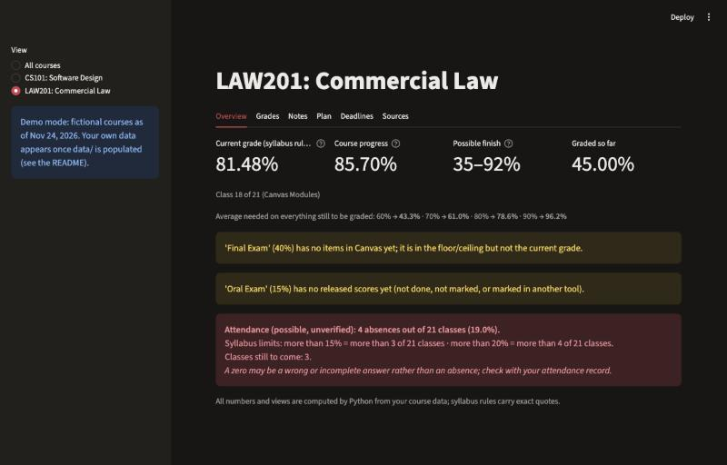
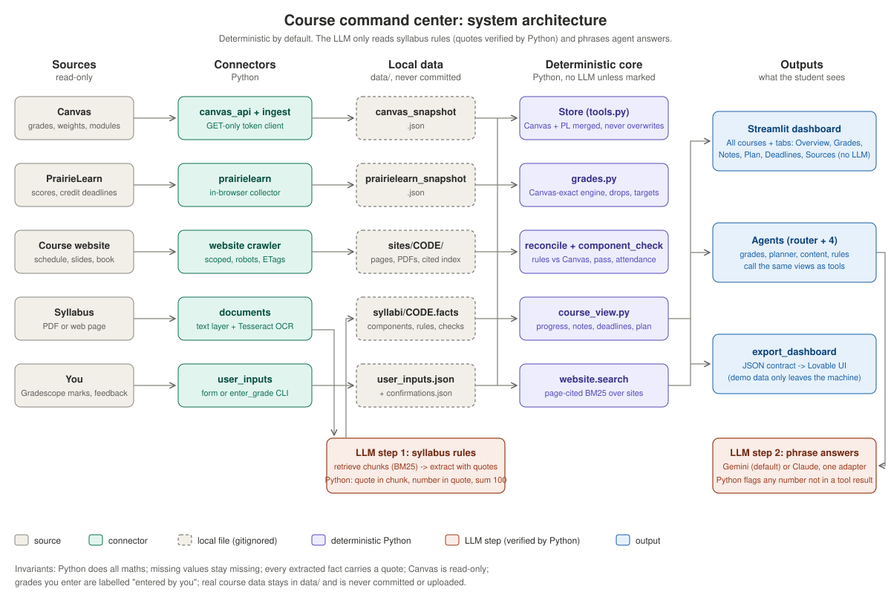
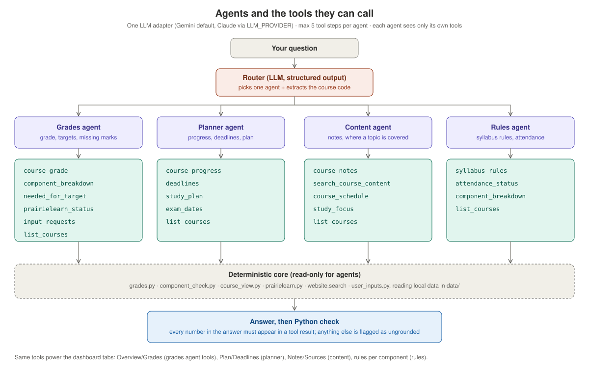
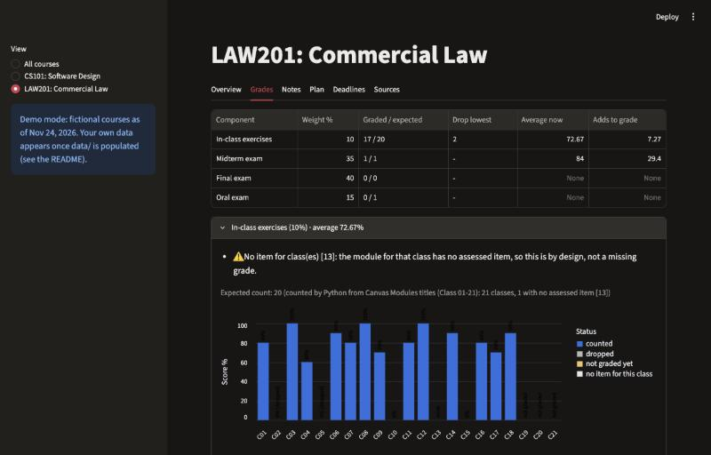

# Course Command Center

**Connect a course (Canvas, PrairieLearn, the course website, the syllabus) and get an exact current grade, how far
the course has got, notes from week 1 to now, a day-by-day plan and every deadline in one place, with every number
computed by Python and every syllabus rule backed by a quote.**



## Why it exists
A student's course is split across Canvas, PrairieLearn, Gradescope, a course website and a PDF syllabus, and Canvas
is often set up differently from the syllabus (missing weights, components split or merged, drop rules not applied).
Asking an LLM "what's my grade?" fails in exactly the ways that matter: it guesses weights, does arithmetic badly, and
invents dates and rules. Here the LLM only **reads** the syllabus (every extracted rule must quote the source, and
Python rejects anything that does not check out) and **phrases** agent answers (Python flags any number not taken from
a tool). Grades, drop rules, targets, attendance limits, deadlines and plans are all deterministic code.

## How it works




**Stack:** Python 3.13 · Pydantic · Streamlit · httpx + BeautifulSoup · pypdf / pypdfium2 + Tesseract OCR ·
rank-bm25 · Gemini (`google-genai`) or Claude (`anthropic`) behind one adapter · pytest + GitHub Actions.
A second front end, **Semester Orbit** (`web/`, plain HTML/CSS/JS), draws the same numbers from the JSON contract
(`scripts/export_dashboard.py`).

## Results
Full method, failures and caveats in [docs/EVALUATION.md](docs/EVALUATION.md) (measured 2026-11-24, real courses
reported in aggregate).

| What | Result |
|---|---|
| Grade engine vs Canvas's own totals (where Canvas shows them) | **2 / 2** courses match on both current and final views |
| Syllabus weights grounded and summing to 100 (`gemini-3.8-flash`, 5 syllabi) | **5 / 5** |
| Extracted weights vs Canvas group weights (3 weighted courses) | **16 / 16** components (13 exact, 2 split, 2 merged); 13 / 16 on the first pass |
| Failures found on real data and fixed with regression tests | 11 (see EVALUATION.md) |
| Offline tests | 118, run in CI on every push |

Caveat: no held-out syllabi yet, so 16 / 16 is optimistic for unseen courses.

## Try the demo (no API key, no accounts)
Two fictional courses (`demo_data/`) run through the real pipeline with recorded model responses.

```bash
python3.13 -m venv .venv
```
```bash
.venv/bin/pip install -r requirements.txt
```
```bash
.venv/bin/streamlit run app.py
```
With no `data/` folder the dashboard opens the demo: All courses, then per-course tabs Overview, Grades, Notes, Plan,
Deadlines, Sources. Run the offline tests:
```bash
.venv/bin/python -m pytest -q
```
Or open the Orbit UI (all courses as planets, a 14-day timeline, the same six tabs per course) at http://127.0.0.1:8503:
```bash
.venv/bin/python -m scripts.serve_web
```
Optional: `brew install tesseract` (or `apt-get install tesseract-ocr`) for OCR of image-only PDFs; the one real-OCR
test is skipped without it.



## Use it on your own courses
```bash
cp .env.example .env
```
Fill in `.env` yourself (Gemini or Anthropic key; optional read-only Canvas token). Then, per course:
```bash
.venv/bin/python -m scripts.ingest_canvas --term 2026
```
```bash
.venv/bin/python -m scripts.crawl_site CS101 https://course.example.edu/cs101/ --scope /cs101/
```
```bash
.venv/bin/python -m scripts.syllabus_flow CS101 --live
```
```bash
.venv/bin/python -m scripts.enter_grade CS101 Midterm --score 31 --out-of 40 --source Gradescope --improve "recursion"
```
Everything you pull or enter stays in `data/` (gitignored). The full command list is in [CLAUDE.md](CLAUDE.md).

## Docs
- [Architecture](docs/ARCHITECTURE.md): data flow, agents and tools, how each view is built
- [Evaluation](docs/EVALUATION.md): results, failures, caveats
- [Syllabus flow](docs/SYLLABUS_FLOW.md): OCR, retrieval, grounded extraction, checks
- [Decisions](docs/DECISIONS.md): architecture decision records
- [Use cases](docs/USE_CASES.md): course layouts and which features they need
- [Progress](PROGRESS.md): current state and next steps

## Limitations
- **Gradescope, iClicker and paper exams are not connected**: the dashboard asks you to enter those marks, and labels
  them "entered by you".
- **PrairieLearn has no student API**: its data comes from a collector you run in your own signed-in browser tab.
- **Canvas token path is tested against a fake server only**; the real pulls so far used a signed-in browser session.
- **Notes are extracted outlines** (lecture titles, learning goals, slide titles), not written summaries; image-only
  slides can leak a little OCR noise.
- **Plans are rule-based** (work the day before a deadline, review before exams on your weak areas), not optimised.
- **Exams without a date in the syllabus** ("exam period") get no review blocks until a date is known.
- **No held-out evaluation yet**, and agent answers are smoke-tested rather than scored.
- Quiz generation is not built.
