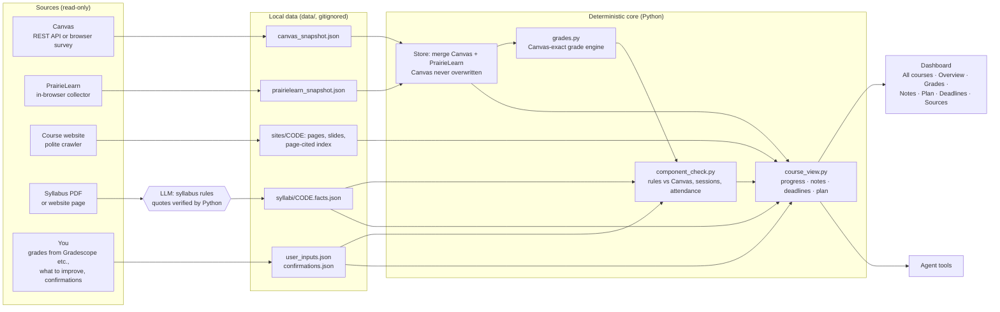
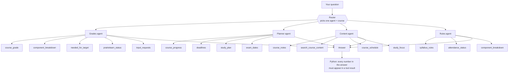

# Architecture

Design rule: **deterministic by default**. Python fetches, parses, counts, schedules and does every calculation.
The LLM is used in exactly two places: reading syllabus rules (with quotes Python verifies) and phrasing agent
answers from tool results (every number checked against those results). The dashboard uses no LLM at all.

## 1. Data flow: sources to views

## 2. Agents and the tools they can call

| Use case | Agent | Tools (all deterministic Python) | Dashboard tab |
|---|---|---|---|
| Current grade, component averages | Grades | `course_grade`, `component_breakdown` | Overview, Grades |
| What do I need for X% | Grades | `needed_for_target` | Overview |
| Marks no system can see | Grades | `input_requests` | Overview (form) |
| PrairieLearn work, pending manual grading | Grades | `prairielearn_status` | Sources |
| How far the course has got | Planner | `course_progress` | Overview, All courses |
| Every deadline and exam | Planner | `deadlines`, `exam_dates` | Deadlines, All courses |
| What to do and when | Planner | `study_plan` | Plan |
| Notes from the start to now | Content | `course_notes` | Notes |
| Where is a topic covered | Content | `search_course_content`, `course_schedule` | Sources |
| What to study after feedback | Content | `study_focus` | Plan (weak areas) |
| Drops, late/missed work, pass rules | Rules | `syllabus_rules`, `component_breakdown` | Grades (rules per component) |
| Attendance limits | Rules | `attendance_status` | Overview |

Every agent shares one adapter (`make_client()`: Gemini by default, Claude with `LLM_PROVIDER=anthropic`), runs at
most 5 tool steps, and can only call the tools in its own list.

## 3. How each view is built (no LLM)

| View | Inputs | Rule |
|---|---|---|
| Grade | Canvas + PrairieLearn + your entries + syllabus weights/rules | Canvas gradebook rules; syllabus weights when found; your entries labelled "(entered by you)" |
| Progress | Website schedule weeks, else Canvas Modules classes, else dated items | first available source, stated on screen |
| Notes | Website slide decks, else Canvas modules | lecture title, learning goals, slide titles; repeated headers and code removed; in course order |
| Deadlines | Canvas, PrairieLearn, website schedule, syllabus exams | same local day + matching key ("D4" = "DELIV4") = one entry with all sources |
| Plan | Deadlines + your improvement areas + low components + course units | work block the day before each deadline; review 7/4/2/1 days before each exam |
